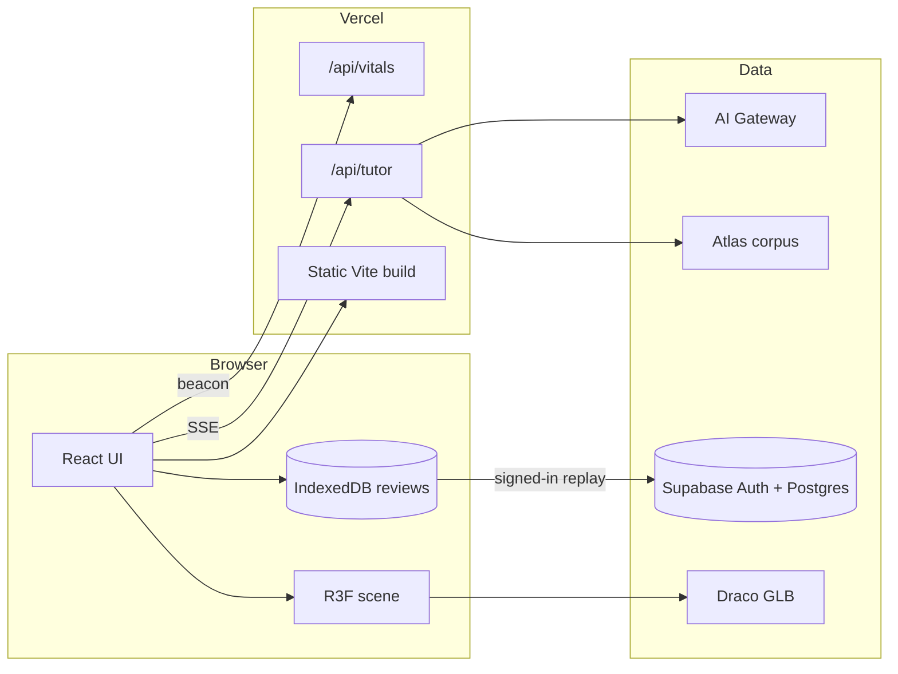

# Anatomy Atlas

An interactive 3D skeleton for anatomy students: explore 200+ bones, landmarks, and joints, quiz yourself with FSRS spaced repetition, and ask a grounded AI tutor that can move the camera.

Educational use only. Not medical advice.

## Features

- **Explore.** Click a bone, search, or follow a guided walk. Looks (atlas, ivory, radiograph, mastery), section planes, and explode-apart spread.
- **Study.** Multiple-choice, typed, locate, and self-grade. FSRS schedules reviews; a mastery heatmap paints the skeleton by recall.
- **Tutor.** Streaming chat grounded in this atlas. Citations open the matching structure. Validated tool calls select bones, joints, landmarks, looks, walks, and quizzes. Out-of-scope questions are refused.
- **Progress.** Local IndexedDB for guests; optional sign-in (magic link / OAuth) syncs an append-only review log through Supabase RLS.
- **Shareable views.** The URL is the camera, the selection, and the walk step.

## Architecture



The 3D scene, the tutor panel, and the progress dashboard are separate chunks. The tutor function is a Vercel Build Output API bundle (`scripts/build-vercel.ts`) with a 30 s streaming limit.

## Technical highlights

- **Grounded tool-using tutor.** Vercel AI SDK v7 UI message streams, Zod-validated viewer tools, BM25 retrieval (title ×3, aliases ×2, body ×1) with citation chips and a "not covered" refusal. 69 eval cases; BM25 recall **0.96** at k = 6. Live LLM metrics (groundedness, tool accuracy, refusals, p50/p95 latency, cost) run from `npm run eval` and `.github/workflows/evals.yml` once AI Gateway is billed. Retrieval tradeoff: [ADR 0001](docs/adr/0001-retrieval.md).
- **FSRS in the client.** `ts-fsrs` with a fake clock in tests, IndexedDB repository, review-due queue, self-grade in reveal mode, Recharts dashboard (lazy), mastery look on the mesh.
- **Offline-first sync.** Append-only review log, UUID de-dupe, RLS on `reviews` and `saved_views`. Guests never download `supabase-js`. [ADR 0002](docs/adr/0002-supabase.md), [ADR 0004](docs/adr/0004-sync.md).
- **Demand rendering.** `frameloop="demand"`, store-driven `invalidate()`, one-shot contact shadows, adaptive DPR from back-to-back frame times. Idle GPU: **0 frames / 5 s** (was 300). Orbit draw calls **263** (was 520). [docs/perf.md](docs/perf.md).
- **Budgets in CI.** Render-blocking JS ≤ 240 kB gzip, first-load JS ≤ 560 kB gzip, Lighthouse CI on desktop and mobile.

## Tutor evals

| Check                                                            | Result                                                                                                                                                   |
| ---------------------------------------------------------------- | -------------------------------------------------------------------------------------------------------------------------------------------------------- |
| Cases                                                            | 69 (grounded, tool, refusal, safety, study, partial)                                                                                                     |
| BM25 recall @ k=6                                                | 0.96 (gate ≥ 0.85). Misses: `fact-ankle-bumps`, `fact-foramen-magnum`                                                                                    |
| LLM judge (groundedness, tools, refusals, safety, latency, cost) | Not yet: AI Gateway still requires a card on the Vercel team. `npm run eval -- --mode bm25` writes `evals/results/` when it works; paste the table here. |

The runner compares `--mode bm25|embedding|hybrid`. Embedding index: `npm run tutor:embeddings`.

## Performance

|                                              | Before (`e0d504f`) | After       |
| -------------------------------------------- | ------------------ | ----------- |
| Render-blocking JS, gzip                     | 500 kB             | **216 kB**  |
| Idle frames / 5 s (GPU)                      | 300                | **0**       |
| Orbit draw calls                             | 520                | **263**     |
| Skeleton GLB                                 | 3.26 MB            | **3.06 MB** |
| Lighthouse desktop performance (median of 3) | 71                 | **91**      |

Full tables, Lighthouse assertions, and the Draco vs meshopt comparison: [docs/perf.md](docs/perf.md), [ADR 0003](docs/adr/0003-draco-vs-meshopt.md).

## Setup

```bash
nvm use
npm ci
cp .env.example .env.local
npm run dev
```

`TUTOR_MOCK=1` (in `.env.example`) drives `/api/tutor` with a scripted model so the chat UI works without AI Gateway.

```bash
npm run check          # typecheck, lint, format, unit tests with coverage
npm run test:e2e       # Playwright (SwiftShader)
npm run db:start && npm run db:test && npm run test:integration
npm run build:vercel   # static site + api/tutor + api/vitals
```

### Environment

| Name                                | Where             | Purpose                                                           |
| ----------------------------------- | ----------------- | ----------------------------------------------------------------- |
| `AI_GATEWAY_API_KEY`                | server, CI secret | Tutor and evals. On Vercel, OIDC can replace this.                |
| `TUTOR_MOCK`                        | server            | `1` for the scripted model.                                       |
| `TUTOR_MODEL`                       | server            | Default `anthropic/claude-haiku-5.5`.                             |
| `VITE_SUPABASE_URL`                 | client            | Optional accounts. Also accepted as `SUPABASE_URL` at build time. |
| `VITE_SUPABASE_ANON_KEY`            | client            | Anon or publishable key only. Never a service-role key.           |
| `UPSTASH_REDIS_REST_URL` / `_TOKEN` | server            | Shared tutor rate limit. In-memory per instance without them.     |

Hosted migrations need `SUPABASE_ACCESS_TOKEN`, `SUPABASE_DB_PASSWORD`, and `SUPABASE_PROJECT_REF`. Preview deploys need `VERCEL_TOKEN`, `VERCEL_ORG_ID`, and `VERCEL_PROJECT_ID`.

## Accessibility

- Skip link to bone details, `sr-only` viewer description, named tabs and landmark groups.
- Keyboard: `j` focuses search, arrow keys move the list, `Escape` clears the selection, study mode is fully operable without the canvas.
- `prefers-reduced-motion` skips the arrival animation and look blends.
- Visual regression and Lighthouse accessibility (≥ 0.85) run in CI. Known gap: the WebGL canvas itself is not a complete alternative to the navigator; the lists and details panel are.

## Model credit

Skeleton geometry is the [Open3DModel](https://anatomytool.org/open3dmodel) by the Open3D project, George J.R. Maat, LUMC, Eungyeol Lee, LUMC, and contributors, **CC BY-SA**. It is based on BodyParts3D and Z-Anatomy. This app mirrors right-sided bones to show the left side and downsizes 38 normal maps from 1024×1024 to 512×512. Geometry, names, and materials are otherwise unchanged. See `public/models/CREDITS.txt`.
